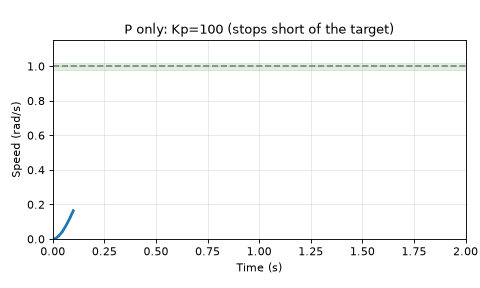
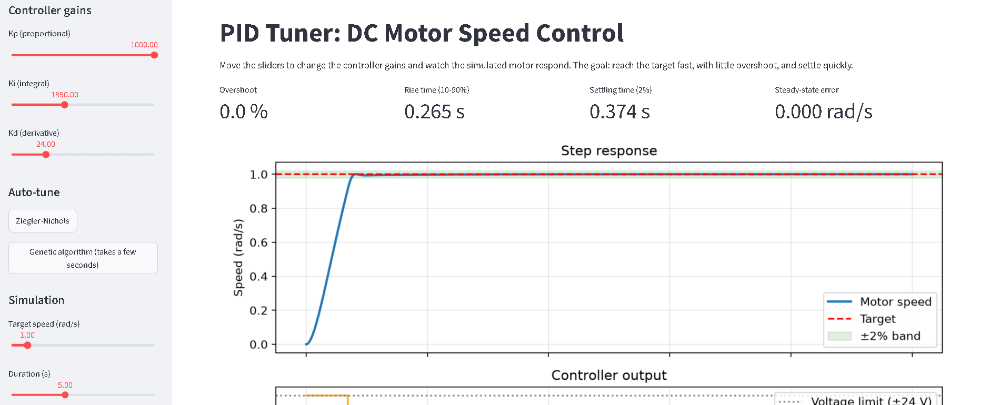
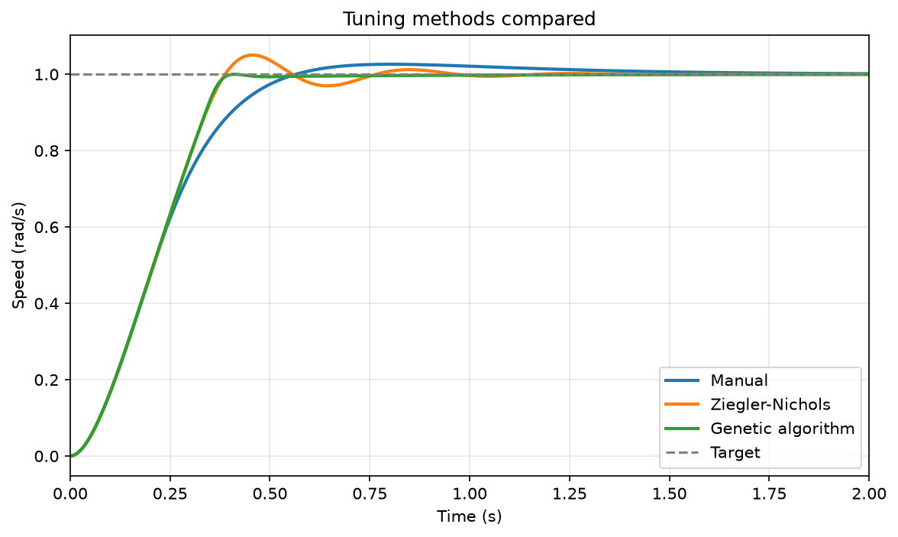
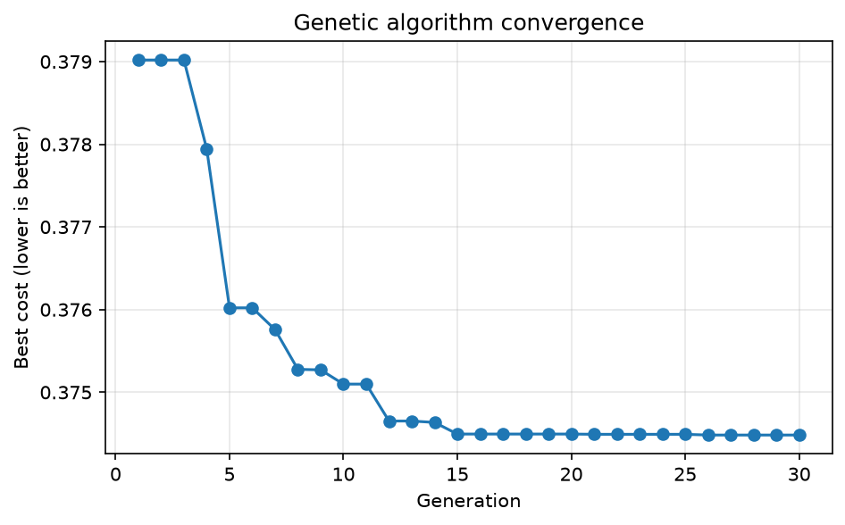

# PID Tuner: DC Motor Speed Control

An interactive web app that simulates a DC motor under PID control, reports overshoot, rise time and settling time live, and compares three ways of choosing the gains: manual tuning, Ziegler-Nichols, and a genetic algorithm.

**[Try the live app](https://pid-tuner-cfvny6n8x9xmawlns3pzmk.streamlit.app/)**





## What it does

- Simulates a DC motor (voltage in, shaft speed out) from its electrical and mechanical equations.
- A PID controller with a ±24 V output limit and anti-windup drives it to a target speed.
- Sliders for Kp, Ki and Kd update the step response and four metrics instantly.
- Two auto-tuners fill in the gains with one click: Ziegler-Nichols (reaction-curve method) and a genetic algorithm.

## Results

Target speed 1 rad/s, 1 ms simulation step.

| Method | Kp | Ki | Kd | Overshoot (%) | Rise (s) | Settling (s) | SS error |
|---|---|---|---|---|---|---|---|
| Manual | 100.0 | 200.0 | 10.0 | 2.63 | 0.330 | 1.032 | 0.0000 |
| Ziegler-Nichols | 169.6 | 1606.6 | 4.5 | 5.05 | 0.267 | 0.703 | 0.0000 |
| Genetic algorithm | 999.3 | 1845.9 | 24.4 | 0.00 | 0.265 | 0.374 | 0.0000 |



## What I found

- **The genetic algorithm gave the fastest settling (0.374 s) with no overshoot**, against 0.703 s and 5% overshoot for Ziegler-Nichols.
- **Rise time is about 0.265 s for every high-gain result.** The 24 V supply limit caps how fast the motor can accelerate, so tuning cannot beat it.
- **The classic "ultimate gain" Ziegler-Nichols method does not work on this motor**, because raising Kp never produces a sustained oscillation. I used the reaction-curve version instead, which measures the open-loop step response.
- **Derivative gain has a sweet spot.** At Kp=100, Ki=200, Kd=5 removed the overshoot entirely, but Kd=50 produced 25% overshoot.
- **The genetic algorithm's edge is small here.** A plain random search with the same number of simulations (1200) scored a cost of 0.377 against the GA's 0.374, so this problem is forgiving. Five different random seeds all gave about 0.374 s settling.



## Project structure

| File | Purpose |
|---|---|
| `motor.py` | DC motor model (two differential equations, Euler integration) |
| `pid.py` | PID controller with output limits and anti-windup |
| `sim.py` | Runs a closed-loop simulation and computes the metrics |
| `autotune.py` | Ziegler-Nichols and genetic algorithm |
| `app.py` | Streamlit web app |
| `compare.py` | Builds the comparison table and plots |
| `make_demo_gif.py` | Builds the demo GIF |

## Run it yourself

```bash
git clone https://github.com/Isaac-Otori/pid-tuner.git
cd pid-tuner
python -m venv venv
venv\Scripts\activate        # Mac/Linux: source venv/bin/activate
pip install -r requirements.txt
streamlit run app.py
```

## Limitations

- Everything is simulated. There is no sensor noise, delay or changing load, and high gains (especially Kd) would amplify noise on real hardware.
- The genetic algorithm's cost function (settling time + 0.1 × overshoot + 10 × steady-state error) is my own choice. A different weighting would give different gains.
- The genetic algorithm pushed Kp to the upper bound I set (1000), so the bound limits the answer.
- Motor parameters are the standard textbook values (J=0.01, b=0.1, K=0.01, R=1, L=0.5).

## Next steps

- Add measurement noise and compare how robust each tuning is.
- Try a real motor with an encoder (e.g. on a Raspberry Pi or Arduino).
- Add other tuners (Cohen-Coon, Bayesian optimisation).